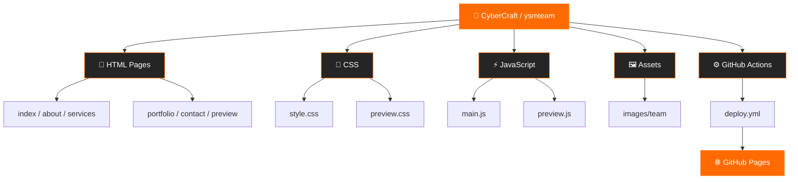

<div align="center">

# 🟠 CyberCraft

### WEB DEVELOPMENT • CREATIVE DESIGN • DIGITAL EXPERIENCES

**Создаём современные сайты, интерактивные интерфейсы и цифровые решения.**

Корпоративный сайт команды веб-разработки с портфолио, услугами, демонстрационными проектами и информацией об участниках.

Тёмный дизайн • Оранжевые акценты • Интерактивный 3D • Плавные анимации

[](https://bobojonanaev2-code.github.io/ysmteam/)
[](https://github.com/bobojonanaev2-code/ysmteam)
[](https://github.com/bobojonanaev2-code/ysmteam/actions)

**Статус публикации**

[](https://github.com/bobojonanaev2-code/ysmteam/actions/workflows/deploy.yml)

---

### 🌐 [ОТКРЫТЬ САЙТ CYBERCRAFT](https://bobojonanaev2-code.github.io/ysmteam/)

</div>

## 📖 О проекте

**CyberCraft** — корпоративный сайт команды веб-разработчиков, объединяющий современный веб-дизайн, интерактивные технологии и демонстрацию возможностей команды.

Сайт выполнен в тёмной цветовой гамме с яркими оранжевыми акцентами. Особое внимание уделено визуальным эффектам, 3D-анимациям, плавности взаимодействия и адаптивной вёрстке.

### ✨ Основные возможности

- 🎨 Современный адаптивный интерфейс.
- 🌐 Главная страница с услугами, проектами и шестью примерами сайтов.
- 🟠 Интерактивная каркасная 3D-сфера с логотипом.
- 🔄 Постоянное вращение, свечение и мягкая деформация сферы при наведении.
- 🖱️ Плавная инерционная прокрутка и параллакс-эффекты.
- ⚡ Анимации появления элементов и интерактивные карточки.
- 🎵 Фоновая эмбиент-музыка и звуковые эффекты интерфейса.
- 🔊 Переключатель звука с сохранением пользовательских настроек.
- 📱 Адаптация под разные размеры экранов.
- 🚀 Автоматическая публикация через GitHub Actions.

---

## 🔗 Полезные ссылки

| Ресурс | Назначение |
|:---|:---|
| 🌍 [CyberCraft Website](https://bobojonanaev2-code.github.io/ysmteam/) | Опубликованный сайт |
| 📦 [GitHub Repository](https://github.com/bobojonanaev2-code/ysmteam) | Исходный код |
| ⚙️ [GitHub Actions](https://github.com/bobojonanaev2-code/ysmteam/actions) | Запуски автоматизации |
| 🚀 [Deploy Workflow](https://github.com/bobojonanaev2-code/ysmteam/actions/workflows/deploy.yml) | Процесс публикации |
| 📜 [Deployments](https://github.com/bobojonanaev2-code/ysmteam/deployments) | История публикаций |
| 🛠️ [Environments](https://github.com/bobojonanaev2-code/ysmteam/settings/environments) | Окружения проекта |

> [!NOTE]
> Версия сайта на GitHub Pages зависит от последней успешной публикации. Изменение только README не обновляет страницы сайта. Для обновления дизайна необходимо отправить актуальные файлы в репозиторий и дождаться завершения деплоя.

---

## 🖥️ Страницы сайта

| Страница | Описание |
|:---|:---|
| 🏠 `index.html` | Главная страница с услугами и проектами |
| 👥 `about.html` | Информация о команде |
| 🛠️ `services.html` | Услуги веб-разработки |
| 💼 `portfolio.html` | Портфолио выполненных работ |
| 📩 `contact.html` | Контакты и форма обратной связи |
| 🎭 `preview.html` | Демонстрационные сайты и примеры проектов |

### 🎭 Демонстрационные проекты

На сайте представлены шесть демонстрационных направлений, каждое из которых имеет собственное оформление и содержание.

| Направление | Идентификатор | Тематика |
|:---|:---|:---|
| 👗 Fashion Atelier | `atelier` | Мода и стиль |
| ✈️ Travel | `travel` | Путешествия |
| 💳 Finance | `finance` | Финансовые сервисы |
| 🍽️ Restaurant | `restaurant` | Ресторанный бизнес |
| 🏛️ Architecture | `architecture` | Архитектура и дизайн |
| 🌿 Wellness | `wellness` | Здоровье и образ жизни |

Демонстрационные сайты открываются через `preview.html` с параметром `site`.

Пример:

```text
preview.html?site=atelier
```

Карточки проектов используют параметр `project`.

---

## 🛠️ Технологический стек

<div align="center">


</div>

| Технология | Использование |
|:---|:---|
| **HTML5** | Структура страниц |
| **CSS3** | Стилизация, адаптивность и анимации |
| **JavaScript** | Логика интерфейса и взаимодействия |
| **Three.js** | Интерактивная 3D-графика |
| **Web Audio API** | Музыка и звуковые эффекты |
| **Git / GitHub** | Контроль версий и совместная работа |
| **GitHub Pages** | Хостинг статического сайта |
| **GitHub Actions** | Автоматическая публикация |

---

## 📂 Структура проекта

```text
ysmteam/
│
├── 📄 index.html          # Главная страница
├── 📄 about.html          # Команда
├── 📄 services.html       # Услуги
├── 📄 portfolio.html      # Проекты
├── 📄 contact.html        # Контакты
├── 📄 preview.html        # Демонстрационные сайты
│
├── 📁 css/
│   ├── style.css          # Стили основного сайта
│   └── preview.css        # Стили примеров
│
├── 📁 js/
│   ├── main.js            # 3D, анимации, звук, интерфейс
│   └── preview.js         # Логика демонстрационных сайтов
│
├── 📁 images/
│   └── team/              # Фотографии участников
│
├── 📁 .github/
│   └── workflows/
│       └── deploy.yml     # Автоматическая публикация
│
├── 📄 style.css           # Копия стилей в корне
├── 📄 main.js             # Копия скрипта в корне
└── 📄 README.md           # Документация
```

### 🗺️ Схема архитектуры



> [!IMPORTANT]
> Основные страницы используют `css/style.css` и `js/main.js`. В корне проекта также находятся копии `style.css` и `main.js`. При внесении изменений необходимо следить за их синхронизацией.

---

## 💻 Локальный запуск

Проект является статическим сайтом. Для его запуска не требуется установка пакетов или отдельная сборка.

### Способ 1 — через браузер

1. Скачайте или клонируйте репозиторий.
2. Откройте папку проекта.
3. Запустите файл `index.html` в браузере.

### Способ 2 — через локальный сервер

Клонируйте репозиторий:

```bash
git clone https://github.com/bobojonanaev2-code/ysmteam.git
```

Перейдите в папку:

```bash
cd ysmteam
```

Запустите локальный сервер при наличии Python:

```bash
python -m http.server 8000
```

Откройте в браузере:

```text
http://localhost:8000
```

> [!NOTE]
> Для полной загрузки сайта необходимо подключение к интернету: Google Fonts предоставляет шрифты, Three.js загружается с CDN, а часть фотографий — с Unsplash.

---

## ✏️ Где редактировать сайт

| Что необходимо изменить | Файл или каталог |
|:---|:---|
| Тексты, ссылки и разделы страниц | Соответствующий `.html` |
| Цвета, шрифты, отступы и адаптивность | `css/style.css` |
| 3D-сферу, анимации и движение | `js/main.js` |
| Прокрутку, музыку и звуковые эффекты | `js/main.js` |
| Содержание примеров сайтов | `js/preview.js` |
| Оформление примеров сайтов | `css/preview.css` |
| Фотографии участников | `images/team/` |
| Автоматическую публикацию | `.github/workflows/` |

---

## 🚀 CI/CD и публикация

Для публикации используется **GitHub Actions + GitHub Pages**.

Основной workflow `deploy.yml` настроен на публикацию статического содержимого корня проекта при отправке изменений в ветку `main`.

### 🔄 Процесс публикации


### 📋 Как опубликовать обновления

1. Загрузите актуальные HTML-файлы, папки `css`, `js`, `images` и остальные необходимые ресурсы в репозиторий.
2. В настройках GitHub Pages выберите публикацию через **GitHub Actions**.
3. Если включены два процесса публикации, оставьте один используемый workflow.
4. Дождитесь успешного завершения процесса в разделе [Actions](https://github.com/bobojonanaev2-code/ysmteam/actions).
5. Проверьте адрес публикации в окружении `github-pages`.

Если браузер показывает предыдущую версию дизайна, выполните принудительное обновление страницы:

**`Ctrl + F5`**

---

## ⚡ Особенности реализации

### 🟠 Интерактивная 3D-сфера

- Постоянное вращение.
- Каркасная структура с логотипом.
- Свечение и визуальные эффекты.
- Мягкая деформация при наведении курсора.
- Анимация с учётом пользовательских настроек движения.

### 🖱️ Анимации и прокрутка

- Плавное замедление после прокрутки.
- Параллакс-эффекты.
- Анимации появления контента.
- Интерактивное поведение карточек.

При включённой системной настройке уменьшения движения анимация сферы ограничивается, а дополнительная инерция колеса прокрутки отключается.

### 🎵 Звуковое оформление

- Спокойная фоновая эмбиент-музыка.
- Звуки взаимодействия с кнопками.
- Переключатель включения и выключения звука.
- Сохранение выбора пользователя.

Если браузер блокирует автоматическое воспроизведение, музыка запускается после первого пользовательского взаимодействия — клика или нажатия клавиши.

### 📩 Формы и демонстрационные функции

> [!WARNING]
> Контактная форма основного сайта пока показывает локальное подтверждение. Для настоящей отправки заявок требуется подключение обработчика или внешнего сервиса форм.

Демонстрационные сайты предназначены для показа дизайна и интерфейсов. Реальные платежи, бронирования и обработка заявок требуют отдельных интеграций.

---

## 👥 Команда CyberCraft

Над проектом работает команда из четырёх участников, каждый из которых отвечает за отдельное направление разработки.

| Участник | Роль | Зона ответственности | GitHub |
|:---|:---|:---|:---|
| **Бобожон Анаев** | 👑 Team Lead / Project Manager | Создание репозитория, настройка GitHub Pages, управление проектом, координация команды, 3D-дизайн | [@bobojonanaev2-code](https://github.com/bobojonanaev2-code) |
| **Ярослав Рыжов** | ⚙️ DevOps Engineer | Настройка CI/CD-пайплайнов, автоматизация деплоя | [@karat05](https://github.com/karat05) |
| **Сергей Сорочинский** | 💻 Frontend Developer | HTML-структура, вёрстка страниц, подготовка текстов | [@f1ble](https://github.com/f1ble) |
| **Илья Миронов** | 🎨 UI/UX Developer | CSS-стили, визуальный интерфейс, интерактивные JavaScript-анимации | [@yeletsyungg](https://github.com/yeletsyungg) |

---

<div align="center">

## 🟠 CYBERCRAFT

### FROM IDEAS TO DIGITAL EXPERIENCES

**Создаём. Разрабатываем. Воплощаем.**

[](https://bobojonanaev2-code.github.io/ysmteam/)
[](https://github.com/bobojonanaev2-code/ysmteam)

---

<sub>© CyberCraft Team • Разработано командой CyberCraft</sub>

</div>

---

## 📜 Права и использование

**© 2026 CyberCraft и авторы соответствующих материалов. Все права защищены.**

Код, тексты, дизайн, логотип, фотографии и другие оригинальные материалы проекта нельзя копировать, изменять, публиковать, распространять или использовать в других проектах без предварительного письменного разрешения правообладателей. Сторонние материалы могут принадлежать своим авторам и использоваться на условиях их лицензий.

Полный текст условий — в файле [`LICENSE`](LICENSE). Публичное размещение репозитория позволяет просматривать его на GitHub, но само по себе не предоставляет лицензию на повторное использование материалов.
