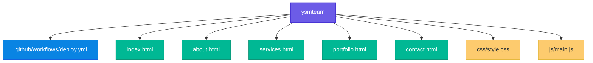

# 🚀 CyberCraft
### Корпоративный сайт команды разработки

  <b>Создаём. Разрабатываем. Автоматизируем.</b>

---

## 🌐 Ссылки на проект

| Ресурс | Описание |
|:---|:---|
| 🌍 **[Живой сайт](https://bobojonanaev2-code.github.io/ysmteam/)** | Открыть сайт CyberCraft |
| 📦 **[GitHub Repository](https://github.com/bobojonanaev2-code/ysmteam)** | Исходный код проекта |
| 🚀 **[История деплоев](https://github.com/bobojonanaev2-code/ysmteam/deployments)** | История публикаций сайта |
| ⚙️ **[Окружения](https://github.com/bobojonanaev2-code/ysmteam/settings/environments)** | Настройки окружений GitHub |

### 📡 Статус автоматического деплоя

---

## 👥 Команда и зоны ответственности

Над проектом работает команда из четырёх участников. У каждого своя роль и зона ответственности.

| Участник | Роль | Зона ответственности | GitHub |
|:---|:---|:---|:---:|
| **Бобожон Анаев** | 👑 Лидер команды / PM | Создание репозитория, настройка GitHub Pages, координация команды, 3D-дизайн | [@bobojonanaev2-code](https://github.com/bobojonanaev2-code) |
| **Ярослав Рыжов** | ⚙️ DevOps-инженер | Настройка CI/CD-пайплайнов, автоматизация деплоя | [@karat05](https://github.com/karat05) |
| **Сергей Сорочинский** | 💻 Программист 1 (Frontend) | Разработка HTML-структуры, вёрстка страниц, подготовка текстов | [@f1ble](https://github.com/f1ble) |
| **Илья Миронов** | 🎨 Программист 2 (UI/UX) | Разработка стилей CSS, интерактивные анимации на JavaScript | [@yeletsyungg](https://github.com/yeletsyungg) |

---

## 📂 Структура проекта

Проект организован с разделением HTML-страниц, стилей, JavaScript и конфигурации автоматического развёртывания.

### 🗂️ Основные файлы

| Файл / каталог | Назначение |
|:---|:---|
| `.github/workflows/deploy.yml` | ⚙️ Конфигурация автоматического деплоя |
| `index.html` | 🏠 Главная страница |
| `about.html` | 👥 Страница о команде |
| `services.html` | 🛠️ Страница услуг |
| `portfolio.html` | 💼 Портфолио проектов |
| `contact.html` | 📩 Контактная страница |
| `css/style.css` | 🎨 Стили и оформление сайта |
| `js/main.js` | ⚡ JavaScript и интерактивность |

---

## 🛠️ Технологии и инструменты

- **HTML** — структура и содержание страниц.
- **CSS** — визуальное оформление и стилизация.
- **JavaScript** — интерактивные элементы и анимации.
- **GitHub** — хранение исходного кода и совместная работа.
- **GitHub Pages** — публикация сайта.
- **GitHub Actions** — автоматизация процесса развёртывания (CI/CD).

---

## 🚀 Публикация проекта

Сайт размещён на GitHub Pages. Процесс публикации автоматизирован с помощью GitHub Actions.

**Открыть сайт:** [CyberCraft — GitHub Pages](https://bobojonanaev2-code.github.io/ysmteam/)

**Проверить статус деплоя:** [GitHub Actions](https://github.com/bobojonanaev2-code/ysmteam/actions/workflows/deploy.yml)

---

  <b>🚀 CyberCraft — превращаем идеи в цифровые решения.</b>
   
  Разработано командой CyberCraft

